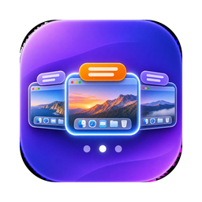
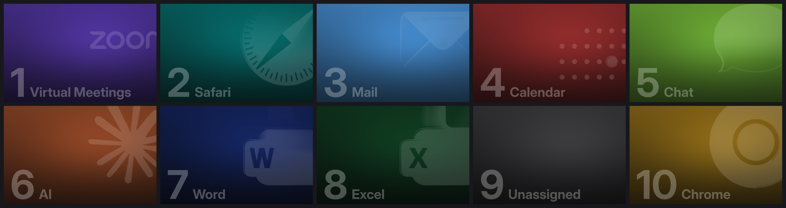

<p align="center"></p>

<h1 align="center">DesktopNames</h1>

<p align="center">Name your Mac desktops (Spaces) the way you can on Windows — and see those names in Mission Control instead of "Desktop 1, Desktop 2…".</p>

---

macOS has never let you rename Spaces. Mission Control always shows *Desktop 1 … Desktop 12*, which is useless once you have more than a few. DesktopNames fixes that **without disabling System Integrity Protection** and without patching the Dock.

## Features

- **Names in Mission Control.** Your names are drawn right over the "Desktop N" labels in the Spaces bar and follow it as it animates. The current desktop is highlighted.
- **Wallpaper label backgrounds (optional).** Give each desktop's label its own image, like that desktop's wallpaper, via *Set Label Image for Current Desktop…*. The current desktop gets a white outline.
- **A default for new desktops.** Any desktop you haven't named can get a default name and image, so every desktop you add with **+** becomes another "Work" area: `defaults write local.desktopnames defaultName Work`.
- **Menu bar label.** Shows the name of the desktop you're on (shortened so it doesn't get pushed behind the notch). Hover for the full name.
- **Rename from anywhere.** Click the menu bar item, or open the app from Spotlight to pop the menu up at your cursor (handy when the menu bar is crowded).
- **Names stick to the desktop, not the number.** Reorder desktops in Mission Control and the names move with them.
- **Multiple displays** supported.
- Tiny: one Swift file, no dependencies.

## Pair it with matching wallpapers

Give each desktop its own color and label so you know where you are even before Mission Control opens:

<p align="center"></p>

Full-size versions (3456×2234) are in [`wallpapers/`](wallpapers), plus an unnumbered `Work.png` for any extra desktops. Set each one in **System Settings → Wallpaper** while you're on that desktop.

## How it works

1. Reads the list of Spaces (and their stable UUIDs) through the read-only `CGSCopyManagedDisplaySpaces` call.
2. Uses the Accessibility API to watch the Dock for Mission Control's `mc.spaces.list` and read where each "Desktop N" button sits.
3. Draws borderless, click-through panels at the shielding window level over those labels.

macOS 26 (Tahoe) reports the collapsed Spaces bar labels above the top of the screen (y < 0) while drawing them ~37 pt down; DesktopNames corrects for that.

## Install

Requires macOS 13+ and the Xcode command-line tools.

```bash
git clone https://github.com/R10ForTheWin/DesktopNames.git
cd DesktopNames
./build.sh            # builds and installs to ~/Applications/DesktopNames.app
open ~/Applications/DesktopNames.app
```

Then grant **System Settings → Privacy & Security → Accessibility → DesktopNames**. That's needed to read Mission Control's layout.

> The build is ad-hoc signed, so macOS resets the Accessibility permission every time you rebuild. Toggle it back on after each build.

To start at login, use **Open at Login** in the app's menu.

## Troubleshooting

- **Menu bar item missing?** Check *System Settings → Menu Bar → Allow in the Menu Bar*, and make room — on notched MacBooks, items that don't fit hide behind the notch. You can always open the app from Spotlight to get its menu.
- **Names not showing in Mission Control?** Choose **Show Log** from the menu. The log at `~/Library/Logs/DesktopNames.log` records what the app found in Mission Control.

## License

MIT
